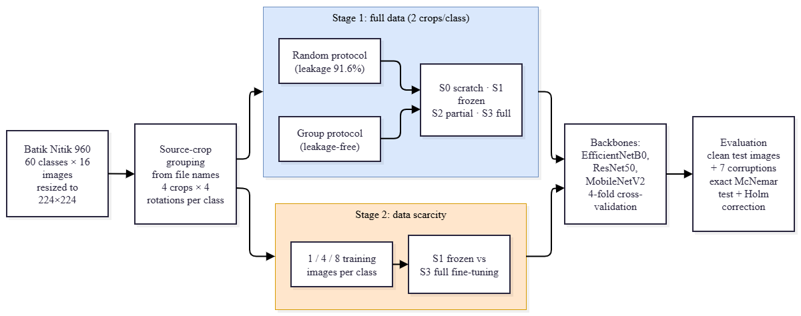
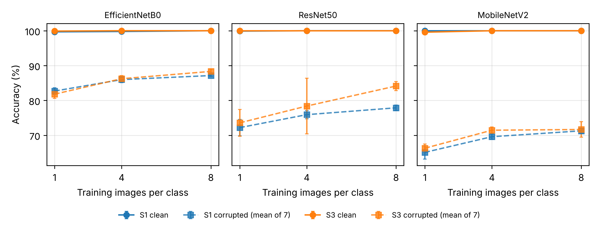

# Frozen versus full fine-tuning under data scarcity and corruption for Batik Nitik

Repositori: <https://github.com/mauprediksikripto-maker/batik-nitik-finetuning-ablation>

Kode, pembagian fold, log, dan hasil lengkap untuk naskah:

> D. Irawan, Sudarmaji, and I. Samsudin, "Frozen versus full fine-tuning under data scarcity and corruption for Batik Nitik," submitted to *Bulletin of Electrical Engineering and Informatics* (BEEI), 2026.

Studi ini membandingkan dua resep transfer learning, yaitu **S1 frozen** (backbone dibekukan, hanya head dilatih, tanpa augmentasi) dan **S3 full** (seluruh backbone dilatih dengan augmentasi), pada tiga backbone ImageNet (EfficientNetB0, ResNet50, MobileNetV2). Pengujian dilakukan pada Batik Nitik 960 dengan protokol **bebas kebocoran** (satu potongan kain sumber per kelas selalu ditahan untuk uji), pada tiga tingkat data latih (1, 4, 8 citra per kelas), dan di bawah tujuh jenis korupsi citra.

## Temuan utama

| | Hasil |
|---|---|
| Akurasi bersih | 99,6–100 % untuk semua backbone dan strategi, bahkan dengan **1 citra per kelas** |
| Inflasi kebocoran | 0 pp: protokol random membocorkan 91,6 % citra uji (rotasi dari potongan yang sama), tetapi akurasi sudah jenuh |
| Ketahanan korupsi | rata-rata 65,1–88,3 %; **backbone lebih menentukan** daripada strategi (8 citra: EfficientNetB0 87,1–88,3 %, ResNet50 77,9–84,1 %, MobileNetV2 71,3–71,7 %) |
| S3 − S1 (rata-rata backbone) | +0,6 / +1,5 / +2,6 pp pada 1 / 4 / 8 citra per kelas; terbesar pada ResNet50 (+6,2 pp, 8 citra) |
| Uji McNemar (Holm) | kondisi bersih: tidak signifikan (p_holm ≥ 0,375); terkorupsi: S1 menang 6/4/2 uji, S3 menang 5/6/8 uji |
| Biaya | waktu latih tahap 2: S1 28–64 s, S3 150–318 s (4–10×); latensi 6,5–15,0 ms/citra (T4) |

Tabel lengkap: [`docs/RESULTS.md`](docs/RESULTS.md), dibangkitkan otomatis dari `results/*.csv`.

<p align="center"></p>
<p align="center"></p>

## Struktur repositori

```
batik-nitik-finetuning-ablation/
├── notebooks/
│   └── batik_ablation_beei.ipynb    # notebook Colab (3 sel) yang dipakai untuk semua eksperimen
├── src/                              # modul yang sama dengan isi notebook, dalam bentuk skrip
│   ├── train_pipeline.py            # Sel 1: dataset, fold, model, training, evaluasi, korupsi
│   ├── supervisor.py                # proses latar belakang: restart pekerja, anggaran waktu
│   ├── analysis.py                  # Sel 2: rekap, McNemar+Holm, grafik, ZIP hasil
│   └── stop_training.py             # Sel 3: menghentikan training dengan aman
├── scripts/
│   └── make_results_md.py           # membangkitkan docs/RESULTS.md dari CSV
├── results/                          # semua hasil numerik (lihat docs/DATA_DICTIONARY.md)
├── figures/                          # gambar naskah + gambar tambahan
├── splits/groups.csv                 # kelas dan potongan kain (grup) tiap citra -> dasar semua fold
├── logs/                             # config, environment, rencana job, 79 riwayat training
├── predictions/                      # prediksi out-of-fold (.npz), lihat predictions/README.md
├── docs/                             # PROTOCOL, REPRODUCIBILITY, RESULTS, DATA_DICTIONARY
├── manuscript/README.md              # pemetaan gambar/tabel naskah -> file di repositori
├── CHANGELOG.md                      # riwayat termasuk koreksi pengelompokan (v1 -> v2)
├── CITATION.cff
├── LICENSE                           # MIT (kode); hasil & gambar CC BY 4.0
└── requirements.txt
```

## Dataset

Dataset **tidak** disertakan di repositori ini (lisensi dan ukuran). Unduh dari sumber resmi:

- Batik Nitik 960, Mendeley Data: <http://doi.org/10.17632/sgh484jxzy.3>
- A. E. Minarno, I. Soesanti, and H. A. Nugroho, "Batik Nitik 960 dataset for classification, retrieval, and generator," *Data*, vol. 8, no. 4, Art. no. 63, 2023, doi: [10.3390/data8040063](https://doi.org/10.3390/data8040063).

960 citra, 60 motif, 16 citra per motif = 4 potongan kain × 4 rotasi (0°, 90°, 180°, 270°). Nama file mengikuti pola `"<no> <nama motif> <potongan 1-4>[_rotate_<90|180|270>].jpg"`; potongan kain dibaca langsung dari nama file (`splits/groups.csv`, kolom `group`).

## Cara menjalankan

### A. Google Colab (cara yang dipakai di naskah)

1. Buka `notebooks/batik_ablation_beei.ipynb` di Colab → *Runtime → Change runtime type → T4 GPU*.
2. Letakkan ZIP/folder dataset di Google Drive (di mana saja; notebook mencarinya otomatis).
3. Jalankan **Sel 1**. Training berjalan sebagai proses latar belakang yang terlepas dari notebook:
   - putus internet, tab ditutup, atau cell dihentikan **tidak** menghentikan training;
   - batas 105 menit per sesi; checkpoint atomik disimpan ke `MyDrive/BEEI_Batik/`;
   - sesi berikutnya: jalankan Sel 1 lagi, job selesai dilewati dan job terpotong dilanjutkan.
4. Di akhir setiap sesi, rekap dan ZIP hasil (`SEMENTARA` atau `LENGKAP`) dibuat lalu diunduh otomatis.
5. **Sel 2** membuat ulang rekap dan ZIP kapan saja. **Sel 3** (`HENTIKAN = True`) menghentikan training dengan aman.

Total 138 job (tahap 1 + tahap 2) diselesaikan dalam beberapa sesi Colab gratis (masing-masing ≤ 2 jam).

### B. Lokal / server dengan GPU

```bash
git clone https://github.com/mauprediksikripto-maker/batik-nitik-finetuning-ablation.git
cd batik-nitik-finetuning-ablation
pip install -r requirements.txt
export PROJECT_DIR=$PWD/BEEI_Batik          # letakkan ZIP dataset di $PROJECT_DIR/data/
python src/train_pipeline.py                  # training (bisa dilanjutkan bila terhenti)
python src/analysis.py                        # rekap, uji statistik, grafik
```

Uji cepat pipeline: `BEEI_SMOKE=1 python src/train_pipeline.py` (epoch dikecilkan). Rincian ada di [`docs/REPRODUCIBILITY.md`](docs/REPRODUCIBILITY.md).

### C. Hanya membangkitkan ulang tabel dan gambar dari hasil yang ada

```bash
python scripts/make_results_md.py             # docs/RESULTS.md dari results/*.csv
```

`src/analysis.py` telah diverifikasi menghasilkan ulang `summary_all.csv`, `table_main_group.csv`, `table_fewshot.csv`, `table_leakage_inflation.csv`, `table_robustness_by_strategy.csv`, `table_robustness_full.csv`, dan `fig_fewshot_curve.png` yang identik dengan file di repositori ini. Uji McNemar (`stats_*.csv`) dan matriks konfusi memerlukan prediksi out-of-fold di `predictions/`.

## Lingkungan

Python 3.13.16 · TensorFlow 2.21.0 · Keras 3.13.2 · Tesla T4 (Google Colab) · mixed precision float16 · seed 42 · 4 fold.

## Catatan kejujuran

- **Akurasi bersih jenuh** (≈100 %), sehingga perbandingan strategi pada data bersih tidak informatif. Perbedaan baru muncul pada kondisi terkorupsi dan data sedikit.
- **Perancu augmentasi:** S1 dilatih tanpa augmentasi (head pada fitur cache), S3 dengan augmentasi. Karena itu yang dibandingkan adalah dua *resep*, bukan murni kedalaman fine-tuning.
- **S0 (dari nol) tidak lengkap:** ResNet50 hanya 2 fold, MobileNetV2 tidak dijalankan.
- **Latensi tahap 1 tidak valid** (pemanggilan eager); gunakan latensi tahap 2.
- Satu seed (42). Variasi antar-seed tidak diukur.
- Versi awal pipeline memakai pengelompokan visual otomatis yang ternyata salah; semua hasilnya dibuang. Lihat [`CHANGELOG.md`](CHANGELOG.md).

## Pernyataan penggunaan AI

Sesuai kebijakan IAES tentang AI generatif: asisten AI (Claude, Anthropic) membantu menulis kode pipeline dan skrip plotting, serta menyunting bahasa dokumentasi. Seluruh eksperimen dijalankan oleh penulis di Google Colab; semua angka dan grafik berasal dari keluaran eksperimen tersebut. Gambar 1 (alur kerja) digambar oleh penulis di draw.io.

## Sitasi

Lihat [`CITATION.cff`](CITATION.cff). Mohon juga sitasi dataset Batik Nitik 960 (Minarno dkk., 2023).

## Lisensi

Kode: MIT (lihat `LICENSE`). Hasil, log, dan gambar: CC BY 4.0. Dataset mengikuti lisensi dari penyedianya.

## Kontak

Dedi Irawan, Fakultas Ilmu Komputer, Universitas Muhammadiyah Metro, Indonesia · dedimti@ummetro.ac.id · ORCID [0009-0007-4973-926X](https://orcid.org/0009-0007-4973-926X)
